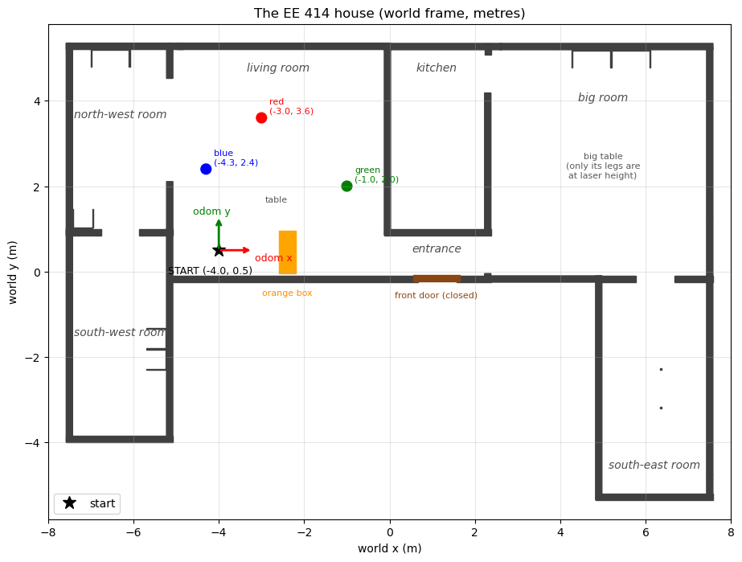

# EE 414 House Lab: a TurtleBot3 in a house

Three hands-on sessions with a simulated **TurtleBot3 Burger** in the **TurtleBot3 House**
world (ROS 2 Jazzy + Gazebo Harmonic). In each session you complete a short program and run it
on the robot. A monitor measures every run and writes the results for your report. You submit
the report at the start of the next lecture.



| Session | You build | Concepts you apply | Guide | Due |
|---|---|---|---|---|
| **Lab 1** | A robot that **wanders around the house without hitting anything** | LaserScan, sectors, sense-decide-act, a state machine, hysteresis | [docs/lab1_reactive_navigation.md](docs/lab1_reactive_navigation.md) | start of Lecture 2 |
| **Lab 2** | A program that **finds the cylinders** with the laser and puts them on the map | polar → Cartesian, clustering, frames, **TF2** (`lookup_transform`, `do_transform_point`, broadcasting) | [docs/lab2_tf2_objects.md](docs/lab2_tf2_objects.md) | start of Lecture 3 |
| **Lab 3** | **Go to a goal**, then the **Bug algorithm** around an obstacle | closed-loop (P) control, angle wrapping, Bug 0 and Bug 2, the m-line | [docs/lab3_bug_algorithm.md](docs/lab3_bug_algorithm.md) | start of Lecture 4 |

Each lab takes about 2 hours: about 1.5 h in the lab session, then the rest at home. You write
**small functions** (5–15 lines each, marked `TODO`). Everything else is already written and
explained in comments, so you can read it.

**Start with the video guide** (12 minutes). It shows the whole lab once, with real runs:
[English](https://youtu.be/_6a2EU7Mmn8) · [Arabic / بالعربي](https://youtu.be/GZesS9U1vdE)

Then watch the **live demos** (5 minutes): real Gazebo recordings of what your robot should do in
each lab. No code, only the behaviour and the measured numbers:
[English](https://youtu.be/RKZsvj5rW00) · [Arabic / بالعربي](https://youtu.be/I4i_-eZtP5Q)

---

## 1. Install (once, 10–40 minutes)

You need **Ubuntu 24.04**: a real installation, or WSL2 on Windows 11 (see
[docs/00_setup.md](docs/00_setup.md)). Open a terminal:

```bash
cd ~
git clone https://github.com/aniskoubaa/ee414_tb3_house_lab.git
cd ee414_tb3_house_lab
./install.sh
```

Type your password when asked. The installer:

1. installs ROS 2 Jazzy, Gazebo Harmonic, TurtleBot3 and the tools,
2. builds the lab in `~/ee414_ws`,
3. adds one line to `~/.bashrc` so every new terminal is ready,
4. runs `./check_setup.sh`, which starts the simulator and **drives the robot** to prove it all works.

When it ends with **`ALL GOOD`**, close the terminal and open a new one.

> Already installed ROS 2 Jazzy, for example from the
> [agentic_robotics](https://github.com/aniskoubaa/agentic_robotics) repository? Run
> `./install.sh` anyway. It only adds what is missing.

## 2. Start the robot

```bash
cd ~/ee414_tb3_house_lab
./lab sim            # terminal 1: Gazebo opens with the robot in the living room
./lab teleop         # terminal 2: drive with w a s d x  (s = stop)
```

## 3. The `lab` command

| Command | What it does |
|---|---|
| `./lab sim` | start the house (`./lab sim nogui` on a weak PC, `./lab sim rviz` to add RViz) |
| `./lab teleop` | drive with the keyboard |
| `./lab rviz` | open RViz with the lab layout |
| `./lab check 1` | **test your Lab 1 code without the simulator** (also `2` and `3`) |
| `./lab run l1_wander` | run one of your programs (or: `ros2 run ee414_house_lab l1_wander`) |
| `./lab monitor 1` | measure a run for your report |
| `./lab stop` | stop everything |
| `./lab doctor` | check the installation again |
| `./lab submit 1 <ID>` | pack your Lab 1 submission into `~/EE414_lab1_<ID>.zip` |

You edit **Python files** in `ee414_house_lab/ee414_house_lab/`. You do **not** need to rebuild
after editing: the next run uses your new code.

## 4. What is in this repository

```
ee414_tb3_house_lab/
├── README.md                 this page
├── install.sh                installs everything, then checks it
├── check_setup.sh            checks everything (also: ./lab doctor)
├── lab                       the helper command
├── docs/                     the guides: setup, Lab 1, Lab 2, Lab 3, cheat sheet, troubleshooting
├── submission/lab1..3/       your REPORT.md for each lab; the monitor saves its results here
├── tests/                    the checks behind ./lab check
├── scripts/                  lab_env.sh (the terminal setup) and submit.sh
└── ee414_house_lab/          the ROS 2 package
    ├── launch/house.launch.py      the world + the robot
    ├── worlds/ee414_house.sdf      the house, the three cylinders, the orange box
    ├── rviz/house_lab.rviz         the RViz layout
    ├── config/gazebo_gui.config    the Gazebo window (opens above the living room)
    └── ee414_house_lab/
        ├── l1_scan_reader.py       Lab 1  TODO 1, 2
        ├── l1_wander.py            Lab 1  TODO 3
        ├── l2_object_finder.py     Lab 2  TODO 1, 2, 3, 4
        ├── l3_go_to_goal.py        Lab 3  TODO 1, 2
        ├── l3_bug.py               Lab 3  TODO 3, 4, 5
        ├── easy_robot.py           the robot node you build on (read it, do not edit)
        ├── lab_monitor.py          measures your runs (do not edit)
        ├── l2_check.py             compares your objects with the truth (do not edit)
        └── world_info.py           where everything is in the house (do not edit)
```

## 5. Rules for the reports

- One report per student, written by you. You may discuss ideas with others, but the code and
  the answers you submit must be your own.
- Numbers in the report come from **your** monitor files, and the zip includes those files.
- Keep answers short: one to three sentences, unless a question asks for more.

## 6. Help

1. Read [docs/troubleshooting.md](docs/troubleshooting.md).
2. Run `./lab doctor` and read the FAIL lines.
3. Ask in the lab session. Bring the output of `./lab doctor`.

---
EE 414 Introduction to Robotics, Alfaisal University, Fall 2026. Prof. Anis Koubaa.
The house world and the robot are the official ROBOTIS TurtleBot3 simulation (Apache 2.0).
