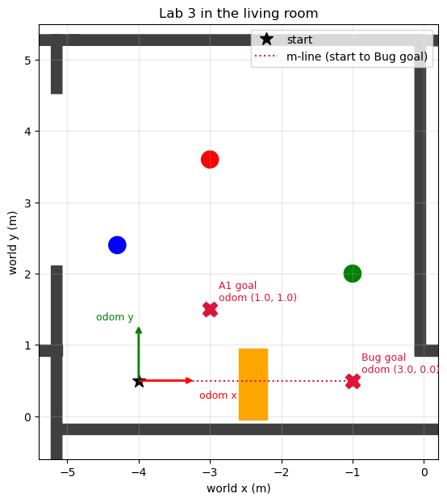

# Lab 3: go to a goal, then the Bug algorithm

**Goal:** your robot drives to a goal point on its own. Then it reaches a goal **behind an
obstacle**, using only its laser and the Bug algorithm: no map, no planner.

**You will write:** five small functions (TODO 1–5) in `l3_go_to_goal.py` and `l3_bug.py`.
**You will submit:** `submission/lab3/REPORT.md`, your monitor results, and your code
(`./lab submit 3 <ID>`), **before Lecture 4**.

| Part | What | Time |
|---|---|---|
| A | Go to a goal: TODO 1, 2 | 35 min |
| B | Bug 0: TODO 3, and the HIT half of TODO 5 | 35 min |
| C | Bug 2: TODO 4, and the LEAVE half of TODO 5 | 30 min |
| D | Compare, and (bonus) drive to a cylinder you found in Lab 2 | 20 min |

All goals are in the **odom** frame: (0, 0) is where the robot starts, +x is the way it faces at
the start (toward the orange box), and +y is to its left.



---

## Part A: go to a goal (35 min)

### The controller

Ten times per second:

```
distance       = how far the goal is
heading error  = (direction to the goal) - (direction the robot faces)      wrapped to -180..180

w = K_TURN  * heading error                                                  limited to MAX_TURN
v = K_DRIVE * distance                                                       limited to MAX_SPEED
    but v = 0 while |heading error| > 45 degrees   (turn first, then drive)
```

This is a **proportional (P) controller**: the command is proportional to the error. Far away
means fast, and close means slow, so the robot does not overshoot.

### TODO 1: `angle_wrap(a)`

The robot faces 170° and the goal is at −170°. Then (−170) − 170 = −340°, which means "turn right
almost a full circle". The right answer is +20°: "turn left a little". **Always wrap the
difference of two angles.** One line: `math.atan2(math.sin(a), math.cos(a))`.

### TODO 2: `go_to_goal_command(x, y, yaw, gx, gy)`

Follow the steps in the docstring. Then:

```bash
./lab check 3            # TODO 1 and TODO 2 must PASS (TODO 3-5 come later)
```

### A1. Run it

```bash
./lab sim                                     # terminal 1
./lab monitor 3 --goal 1.0 1.0                # terminal 2
./lab run l3_go_to_goal 1.0 1.0               # terminal 3
```

The robot turns toward the goal, drives, slows down and stops within 10 cm. The monitor saves
`submission/lab3/lab3_run_*.txt/.png` three seconds after the goal is reached.

### A2. Into the box

Restart `./lab sim`. Now try the goal **behind the orange box**:

```bash
./lab monitor 3 --goal 3.0 0.0
./lab run l3_go_to_goal 3.0 0.0
```

Watch Gazebo **and** the terminal. After about 20 seconds, your program may even print
`GOAL reached`. Then read the monitor summary: `goal reached`, `final error` and
`odom error at end`. The monitor judges by where the robot **really** is.

**A2 (report):** what really happened? Why did your program believe it had arrived? Why can this
controller never reach this goal? (Ctrl-C both programs when you have seen enough. The monitor
still saves.)

---

## Part B: Bug 0 (35 min)

### Two behaviours and a switch

The Bug algorithms use two behaviours you already have:

- **GO_TO_GOAL**: your `go_to_goal_command` from Part A,
- **FOLLOW_WALL**: keep the obstacle on the robot's **right**, 0.35 m away (written for you in
  `follow_wall`: read it, it is a P controller on the distance to the wall),

and a switch between them:

```
                     front < HIT_DIST                 (the HIT point)
   +------------+  ------------------->  +-------------+
   | GO_TO_GOAL |                         | FOLLOW_WALL |
   +------------+  <-------------------  +-------------+
                       the LEAVE rule
```

**Bug 0's leave rule:** leave the wall as soon as **the direction to the goal is clear**.

### TODO 3: `goal_direction_clear(scan, x, y, yaw, gx, gy)`

1. The direction of the goal **seen from the robot**:
   `a = degrees(angle_wrap(atan2(gy - y, gx - x) - yaw))`. This uses the same angles as the
   laser: 0 ahead, + left.
2. The nearest obstacle in a 40° cone around it: `sector_min(scan, a - 20, a + 20)`. This is
   your function from Lab 1.
3. It is clear if that obstacle is farther than `CLEAR_AHEAD` (1 m), **or** farther than the
   goal: an obstacle behind the goal does not matter.

### TODO 5, first half: the HIT

In `switch(front, dist)`: when in `GO_TO_GOAL` and `front < HIT_DIST`, switch to `FOLLOW_WALL`
and remember the hit point (`self.hit_x`, `self.hit_y`) and the distance to the goal there
(`self.hit_dist`). Then write the `FOLLOW_WALL` part for `bug0` (see the docstring).

```bash
./lab check 3            # TODO 1, 2, 3 and 5 must PASS. TODO 4 and 5b are Part C.
```

### B1. Run Bug 0

```bash
./lab sim
./lab monitor 3 --goal 3.0 0.0
./lab run l3_bug 3.0 0.0 --algorithm bug0
```

Watch the terminal: it prints `HIT` and `LEAVE` with the positions. **B1 (report):** copy the
`HIT`/`LEAVE` lines and the monitor summary. Using the path picture, describe in 2–3 sentences
what the robot did around the box.

---

## Part C: Bug 2 (30 min)

**The m-line** is the straight line from the **start** to the **goal**. **Bug 2's leave rule:**
leave the wall only when the robot is **back on the m-line** (within `MLINE_TOL` = 10 cm) **and
closer to the goal than at the hit point**.

Why the second condition? Every time Bug 2 leaves a wall, it is closer to the goal than the last
time it hit one. So it can never go round in circles. Bug 0 has no such guarantee.

### TODO 4: `distance_to_mline(sx, sy, gx, gy, x, y)`

The distance from a point to the line through two points:

```
        | (gx - sx)(sy - y) - (sx - x)(gy - sy) |
  d  =  ----------------------------------------
                 | start -> goal |
```

Check by hand: start (0, 0), goal (4, 0), point (2, 1) gives d = 1.

### TODO 5, second half: Bug 2's leave rule

Complete the `bug2` branch in `switch` (its checks are listed as **TODO 5b**). Then:

```bash
./lab check 3                  # everything must PASS now
./lab sim
./lab monitor 3 --goal 3.0 0.0
./lab run l3_bug 3.0 0.0 --algorithm bug2
```

**Checkpoint C:** Bug 2 reaches (3.0, 0.0) with **0 bumps**. Show the monitor summary.

---

## Part D: compare, and a bonus

### D1. The comparison table

Fill in the table in your report from your three monitor files (A1 is for reference):

| Run | reached? | time (s) | distance driven (m) | min clearance (m) | bumps |
|---|---|---|---|---|---|
| go-to-goal (3, 0) | | | | | |
| Bug 0 | | | | | |
| Bug 2 | | | | | |

**D2 (report):** which one drove the shorter path here? Draw (by hand, photo is fine) an obstacle
shape where **Bug 0 fails** (loops for ever) but **Bug 2 succeeds**.

### D3. Bonus (+2): drive to a cylinder you found yourself

1. Start `./lab sim`, run `./lab run l2_object_finder` (your Lab 2 code), and turn the robot on the
   spot with teleop until it prints `object_0`. Stop teleop.
2. Ask TF2 where `object_0` is in odom: `ros2 run tf2_ros tf2_echo odom object_0`.
3. Choose a goal **0.35 m before** the cylinder, on the side facing the robot, and send Bug 2
   there with the monitor running.

Report the cylinder's position, your goal, and the final distance between the robot and the
cylinder. Did odometry drift matter? Compare the monitor's `odom error` line.

---

## What you submit (before Lecture 4)

1. `submission/lab3/REPORT.md`, with every `_[answer]_` replaced.
2. In `submission/lab3/`: the monitor files for A1, A2, B1 and C (and D3 if you did it).
3. `./lab submit 3 <your student ID>`, then upload `~/EE414_lab3_<ID>.zip`.

### Grading (10 points, +2 bonus)

| Points | For |
|---|---|
| 2 | TODO 1–2 pass, A1 reaches the goal, A2 explained |
| 3 | TODO 3 and TODO 5 (Bug 0) pass, B1 run and explanation |
| 3 | TODO 4 and TODO 5 (Bug 2) pass, and Bug 2 reaches the goal with 0 bumps |
| 2 | D1 table and D2 |
| +2 | D3 bonus |
